# MiniShop SSDLC — Examiner Setup Guide (Windows 10/11)

This guide runs the **original vulnerable MiniShop** and **remediated MiniShop** side by side using Docker Desktop on a Windows PC. It is intended exclusively for authorised university evaluation on a local machine.

## 1. System Requirements

| Requirement | Details |
|---|---|
| Operating system | Windows 10/11 with Docker Desktop-supported version and WSL 2 support |
| CPU | 64-bit processor with hardware virtualisation enabled |
| RAM | At least 8 GB recommended when running Docker Desktop and both applications |
| Storage | At least 5 GB of free space recommended for Docker images, source and volumes |
| Docker | Docker Desktop with Linux containers and Docker Compose v2 |
| Git | Git for Windows |
| Terminal | Windows PowerShell (Windows Terminal optional) |
| Browser | Any current browser, such as Edge or Chrome |
| Optional testing tools | Python 3 and pytest for the regression suite; Burp Suite for interactive DAST |

**No standalone installation of Flask, Gunicorn or SQLite is needed to launch the web applications through Docker.** The supplied Docker builds install application dependencies inside containers. Both applications are intended for authorised localhost-only testing.

## 2. Windows Environment Setup

### 2.1 Enable virtualisation and install WSL 2

1. Check in **Task Manager → Performance → CPU** that **Virtualisation** is enabled. If disabled, enable virtualisation (Intel VT-x or AMD-V) in your computer's BIOS/UEFI.
2. Open **PowerShell as Administrator** and run:

```powershell
wsl --install
wsl --update
```

Restart Windows if requested. If WSL is already installed, the first command is unnecessary. Check installation:

```powershell
wsl --status
wsl --version
```

### 2.2 Install Docker Desktop and Git

- Install [Docker Desktop for Windows](https://www.docker.com/products/docker-desktop/); use the **WSL 2 backend** and **Linux containers**.
- Install [Git for Windows](https://git-scm.com/download/win).
- Start Docker Desktop and wait until its engine is running.

### 2.3 Verify the environment

Open a **new ordinary PowerShell window** and run:

```powershell
docker --version
docker compose version
docker info
git --version
```

All commands should succeed. If `docker info` reports a daemon connection error, open Docker Desktop, confirm the Linux engine is running, and try again.

### 2.4 Network and port configuration

| Version | Windows host address | Docker container port | Container name |
|---|---|---|---|
| Vulnerable | `http://127.0.0.1:5000` | `5000` | `minishop-lab` |
| Remediated | `http://127.0.0.1:5002` | `5000` | `minishop-secure-app` (override) |

Only the **host ports** must differ. Both containers listen on internal port `5000`; the secure application's Compose override sets a distinct container name and image tag. The Compose projects also have separate default named volumes.

Check for existing listeners if a port is occupied:

```powershell
Get-NetTCPConnection -State Listen -LocalPort 5000,5002 -ErrorAction SilentlyContinue
```

Do **not** switch bindings to `0.0.0.0`; the vulnerable project must not be reachable from other machines.

### 2.5 Animated deployment architecture

The following diagram illustrates both MiniShop applications running simultaneously on a Windows host, with separate Docker containers, isolated data and distinct localhost ports.



[Open the animated SVG separately](assets/minishop-dual-environment.svg) if animation is not displayed in the GitHub Markdown preview. The diagram is illustrative; use the Compose commands below for the actual deployment.

## 3. Download both applications

Open PowerShell and run:

```powershell
mkdir "$HOME\MiniShop-SSDLC" -ErrorAction SilentlyContinue
cd "$HOME\MiniShop-SSDLC"

git clone https://github.com/Cryyyybabyyyy/minishop.git
git clone https://github.com/Cryyyybabyyyy/minishop-secure.git
```

If the folders are already present, use `git -C .\minishop pull` and `git -C .\minishop-secure pull` instead of cloning again.

## 4. Start the original vulnerable version

```powershell
cd "$HOME\MiniShop-SSDLC\minishop"
docker compose up --build -d
docker compose ps
```

Open **http://127.0.0.1:5000**.

> **Warning:** This version intentionally contains security vulnerabilities. Keep it bound to localhost. Do not publish ports or expose it to another network.

## 5. Start the remediated version side by side

The two repositories currently use the same fixed Docker container name (`minishop-lab`) and image tag (`minishop:lab`). Before starting the secure version, create an **additional Compose override file** in the secure repository to give it unique names. This only changes the local examiner setup, not the application's source code.

```powershell
cd "$HOME\MiniShop-SSDLC\minishop-secure"

@'
services:
  minishop:
    container_name: minishop-secure-app
    image: minishop:secure
'@ | Set-Content -Encoding utf8 compose.examiner.yaml

# Confirm the combined configuration, including host port 5002
docker compose -f compose.yaml -f compose.examiner.yaml config

# Build and run
docker compose -f compose.yaml -f compose.examiner.yaml up --build -d
docker compose -f compose.yaml -f compose.examiner.yaml ps
```

Open **http://127.0.0.1:5002**.

The repositories use separate project directories, so Docker Compose creates separate project-scoped database/upload volumes. Both applications remain bound to `127.0.0.1`.

## 6. Test accounts

These are **synthetic lab credentials** documented by the project:

| Role | Username | Password |
|---|---|---|
| Customer | `alice` | `alice123` |
| Customer | `bob` | `bob123` |
| Seller | `seller` | `seller123` |

Use the same accounts in each version for comparisons.

## 7. Compare security behaviour

| Assessment | Original (`:5000`) | Secure (`:5002`) |
|---|---|---|
| IDOR, `GET /orders/3` while signed in as Alice | Previously demonstrated cross-user order disclosure | Previously observed HTTP 404 |
| Diagnostics with a harmless semicolon-separated command-test input | Previously demonstrated OS command injection | Previously observed literal input rather than executed commands |
| Seller uploads a PHP test file | Previously demonstrated upload acceptance | Previously observed image-validation rejection |
| Seller uploads a valid PNG | Ordinary application behaviour | Previously confirmed accepted |

These are **previously observed results**, not guarantees of a fresh run. Use a browser or an authorised intercepting proxy to inspect the actual responses. Avoid changing Docker port bindings or testing against external services.

## 8. Inspect logs and stop safely

Original version:

```powershell
cd "$HOME\MiniShop-SSDLC\minishop"
docker compose logs --tail=60
docker compose down
```

Secure version:

```powershell
cd "$HOME\MiniShop-SSDLC\minishop-secure"
docker compose -f compose.yaml -f compose.examiner.yaml logs --tail=60
docker compose -f compose.yaml -f compose.examiner.yaml down
```

`down` preserves the named database and upload volumes. **Do not use `down -v`** unless you intentionally wish to delete the test data and uploaded files.

## 9. Optional: run regression tests

Docker alone is sufficient to launch both web applications. To run the included Python tests directly on Windows, also install a supported Python 3 version, then execute from the secure project directory:

```powershell
cd "$HOME\MiniShop-SSDLC\minishop-secure"
py -m venv .venv
.\.venv\Scripts\python.exe -m pip install -r requirements.txt
.\.venv\Scripts\python.exe -m pip install pytest
.\.venv\Scripts\python.exe -m pytest -v
```

The author's macOS evaluation previously reported **8 passing tests**; results should be independently verified on the examiner's Windows machine. Test execution may depend on the project's local configuration and Python compatibility.

## 10. Troubleshooting

- **Docker daemon unavailable:** Start Docker Desktop; check that WSL 2 and hardware virtualisation are enabled.
- **Port 5000 or 5002 already in use:** Close the other service using that port or edit the host-side port in the relevant Compose file.
- **Container-name conflict:** Ensure Step 4's override file exists and always use both `-f` arguments when managing the secure version.
- **Application not ready:** Check `docker compose ps` and `docker compose logs`, using the applicable command above.
- **Missing seeded accounts:** Check application logs and repository-specific data-initialisation instructions before deleting any volumes.
- **PowerShell script execution policy:** No activation command is required for the optional tests because the virtual environment's Python executable is called directly.

## 11. Project links and evidence

- [Original vulnerable MiniShop](https://github.com/Cryyyybabyyyy/minishop)
- [Remediated MiniShop](https://github.com/Cryyyybabyyyy/minishop-secure)
- [SSDLC assessment evidence](https://github.com/Cryyyybabyyyy/minishop-secure/tree/main/evidence)

**Security notice:** Both projects are classroom lab applications, not production services. Do not expose them to public networks or use real personal information or passwords.
